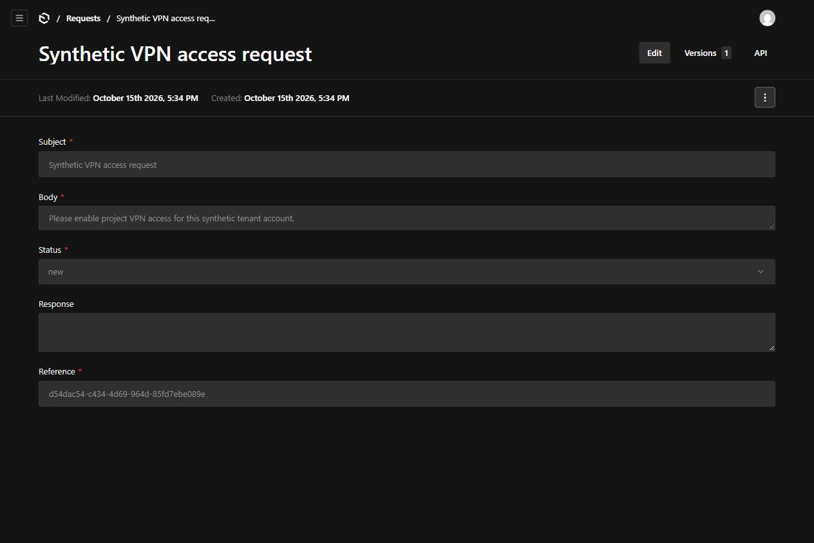

# Tenant Request Portal

A local service-request demo for separate customer companies. Requesters create and read their company's requests; staff update status and respond within their assigned company. The browser uses Payload's existing login, list, create, detail and version forms.



## Linux installation

Use Linux, Git, [Node **24.19.0**](https://nodejs.org/dist/v24.19.0/) and npm **11.17.0** installed together. Ubuntu 24.04/WSL2 is the tested platform. Keep each copy in its own directory; lifecycle commands use that directory even when invoked from another working directory. Dependency downloads are needed unless the exact npm packages already exist in your cache.

```sh
git clone https://github.com/skyon0522-ai/tenant-request-portal.git
cd tenant-request-portal
node --version
npm --version
node scripts/demo.mjs setup
node scripts/demo.mjs start
```

`setup` installs the locked dependencies, compiles the copied tenant plugin, initializes SQLite through Payload's existing CLI/Local API, generates types, builds the production application and typechecks it. It creates `app/.env` with a random local secret and mode `0600`; it never prints that secret. It does not start a development HTTP server or require a seed-flag edit. The production server binds to **127.0.0.1:3230** with telemetry disabled.

The database is `data/demo.sqlite`. Completed initialization has `data/.initialized.json`. Repeating `setup` preserves the database and secret, skips seeding and rebuilds. An existing database without this marker is refused before installation; keep it for inspection and use a separate fresh copy. An interrupted seed can leave partial synthetic data, so no automatic reseed, reset or deletion is provided. Existing unrelated `.env` settings and alternate database paths are refused and preserved. The initializer itself also rejects alternate database/config paths and an existing database before importing the Payload configuration. Lifecycle commands reject symbolic links in protected app, environment and data paths before creating configuration or operation state.

In a second terminal, from this repository:

```sh
node scripts/demo.mjs status
node scripts/request-example.mjs
node scripts/demo.mjs stop
```

`start` stays in the foreground. Ctrl+C also stops its child server. `stop` signals only the live supervisor recorded by this copy's exclusive operation lock, after checking its Linux process start identity. A second setup/start is refused while that lock is held. An occupied port is reported without stopping its owner. No global process-name kills are used.

If a crash or SIGKILL leaves a stale lock, `start` and `stop` refuse it. Inspect `data/.operation.json` and the process list. Only after confirming its recorded process is gone, move that stale lock aside; preserve the database and `.env`. If setup is active, interrupt it in its own terminal. Raw `npm start`/`npm run dev` bypass lifecycle protection; use the commands above for this demo.

## Requester and staff operation

Open **http://127.0.0.1:3230/admin**. All accounts and requests are synthetic; every seeded account has password `demo`.

| Account | Scope |
| --- | --- |
| `requester1@example.test` | Tenant 1 requester |
| `requester2@example.test` | Tenant 2 requester |
| `tenant1@payloadcms.com` | Tenant 1 staff |
| `tenant2@payloadcms.com` | Tenant 2 staff |
| `tenant3@payloadcms.com` | Tenant 3 staff |
| `multi-admin@payloadcms.com` | Staff in all three seeded tenants |
| `demo@payloadcms.com` | Synthetic super-admin |

1. Log in as `requester1@example.test`. Open **Requests → Create New**. Enter **Subject** and **Body**, keep the automatically generated UUID **Reference**, then **Save**. Requests start at `new`.
2. Log out, then log in as `tenant1@payloadcms.com`. Open the request, set **Status** to `in_progress`, enter **Response**, then **Save**. When resolved, set `closed` and save the response.
3. Log out, then log in as the requester again. Open the saved request to read status and response. **Versions** lists retained snapshots. An account in Tenant 2 cannot read this request.

Requesters share visibility within their tenant; this is not a per-author inbox. Requesters cannot change saved requests or set staff status/response at creation. Tenant assignment and user membership/role fields are protected. Staff and super-admin remain inherited demo roles; this does not provide a new organization-administration workflow.

`request-example.mjs` performs the same synthetic create → staff progress → staff close → requester read flow through the REST API, asserting the result and printing its generated reference. It keeps tokens in memory and leaves the request available for browser inspection. Repeat it freely; each run creates one new synthetic request. It does not delete existing data.

## Verification commands

Run from the repository root with the production server running. Boundary and reference probes can run before or after the main API probe, including after manually creating requests. Repeated probes add synthetic requests and retain their versions.

```sh
node scripts/verify-source.mjs
node scripts/lifecycle-guard-test.mjs
node scripts/boundary-extra-test.mjs
node scripts/request-reference-test.mjs
node scripts/requests-api-test.mjs
node scripts/demo.mjs stop
node scripts/demo.mjs start
```

From the second terminal after restart:

```sh
node scripts/requests-api-test.mjs --restart
node scripts/demo.mjs stop
```

The guard regression uses already installed dependencies and disposable native temporary copies. It checks direct-initializer refusal, exact fresh fixtures, repeated initialization and symbolic-link refusal without network access or another install/build. The restart probe reads the marker from the most recent main API run. Test reports and that marker are written to ignored `test-results/`. Preserve this folder across the controlled restart. Prior Windows browser probes remain in `scripts/`; this candidate's Linux verification does not install or automate a browser.

## Implementation and references

The app reuses the pinned [Payload multi-tenant example](original-example/), its [comparison source](baseline-source/), the unmodified copied multi-tenant plugin and the official SQLite adapter. Authentication, forms, validation, storage and retained versions remain existing Payload components. The local lifecycle script adds installation, initialization and process ownership; it is not a deployment or daemon manager. [PROVENANCE.md](PROVENANCE.md) records the source and licenses, and [VERIFICATION.md](VERIFICATION.md) separates current and historical checks.

[Role-Based Access Control Models](https://csrc.nist.gov/csrc/media/projects/role-based-access-control/documents/sandhu96.pdf), Sandhu et al. (1996), §4.1, provides a vocabulary for the role-to-permission relationship used here. Requester and staff permissions are enforced by native collection/field access. Tenant membership supplies an additional application boundary. This mapping does not establish full RBAC model conformance, session activation or separation of duties.

## Limits and security

This is a loopback-only synthetic demonstration. Production deployment, production migrations, backups/restores, identity onboarding and concurrent staff editing require separate work. Ordinary REST updates accept a stale supplied `updatedAt`; reload before editing and coordinate staff changes. Native versions keep at most **20 snapshots per request**. There is no demonstrated compare-and-swap, append-only audit, actor-attributed audit or atomic state/history guarantee.

The production dependency audit refreshed on 2026-10-16 recorded five moderate findings and zero high/critical findings. GitHub execution of the prepared CI workflow, a formal accessibility audit, the full upstream monorepo harness and native Linux browser installation remain unverified. Read [SECURITY.md](SECURITY.md) before adapting the example.
